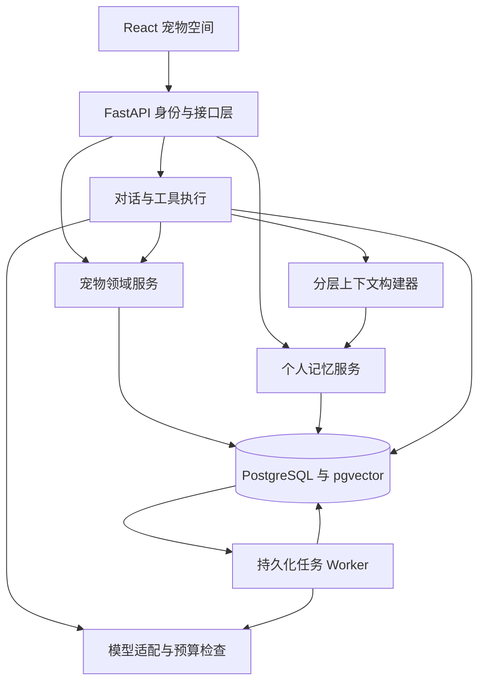

# 喵伴系统架构与实施方案

论文题目：**基于大语言模型与长期记忆机制的虚拟宠物陪伴系统设计与实现**。

产品以持续养成、个人记忆和受预算约束的上下文工程为主线。第一版每个用户一只猫，同一宠物跨会话存在。知识库指个人记忆库，外部养猫资料库留作扩展。

## 1. 产品范围

账号登录、领养命名、中文对话、喂食玩耍清洁休息、时间衰减、离线结算、成长日记、记忆来源纠正与遗忘。界面统一为猫本人。语音、三维、社区和多宠物协作暂不纳入。

## 2. 系统架构

模块化单体、单仓库、API 与 Worker 分进程部署。业务、消息、任务持久化。断线不撤销已提交行为。

## 3. 技术选型

| 层次 | 选型 | 原因 |
| --- | --- | --- |
| 前端 | React 19、TypeScript、Vite、Tailwind 4、Lucide | 沿用基础，重构中文场景 |
| 状态 | Zustand、TanStack Query | 分离交互状态与服务端数据 |
| 对话 | 自有 React 组件、Fetch SSE | 来源、动作、恢复可控，替换 ChatKit 协议 |
| 后端 | Python 3.12、FastAPI、Pydantic | 异步接口与校验 |
| 模型 | OpenAI Agents SDK、Chat Completions | 复用工具调用，兼容现有代理 |
| 数据 | PostgreSQL 17、SQLAlchemy 2、asyncpg、Alembic | 事务与版本化迁移 |
| 召回 | 中文分词、全文检索、pgvector、RRF | 精确字段与语义互补 |
| 任务 | PostgreSQL 任务表、Python Worker | 租约、重试、去重 |
| 测试 | pytest、HTTPX、Vitest、Playwright | 领域、接口、UI 与端到端 |
| 部署 | Docker Compose | 数据库、API、Worker、前端 |

对话保留 `gpt-5-mini` 为初始配置；Embedding 候选 `text-embedding-3-small`，模型、端点、密钥独立配置。实际能力必须联调。无密钥时基础养成仍可用，对话明确不可用；向量失败降级词法检索。依赖锁定版本。向量存储模型、维度和内容哈希，更换模型需重建。小规模先使用过滤后的精确向量搜索。

## 4. 数据模型

| 实体 | 内容 |
| --- | --- |
| users / auth_sessions | 账号、密码哈希、令牌哈希、有效期 |
| pets | 归属、名称、花色、个性、状态、版本、结算时间 |
| conversations / messages | 同一宠物的多个会话、消息与工具交互 |
| pet_events | 行为、结果、状态、幂等键 |
| memories / memory_sources | 类型、键、有效期、替代及遗忘、来源 |
| memory_embeddings | 模型、维度、哈希、向量 |
| conversation_summaries | 摘要、覆盖范围、来源 |
| jobs | 类型、负载、租约、重试及错误 |
| runs | 运行状态、用量、召回、耗时及失败原因 |

所有时间使用带时区 UTC。接口按用户归属隔离；用户级偏好与宠物级经历区分。每个异步任务独立 Session，外部请求不占用数据库行锁。

## 5. 养成规则

状态范围 0～100：饱腹、精力、心情、清洁、亲密度。服务端在读取或执行动作时结算时间，离线衰减上限 24 小时。规则确定、参数集中、时间可注入。休息是有恢复效果的明确动作。有效互动推动成长，重复动作限制刷取。

按钮和工具共用领域服务：归属检查、幂等检查、行锁、结算、条件校验、状态与事件同事务提交。重试返回原事件。真实数值由规则生成，模型负责理解与表达。动画展示已提交结果。

## 6. 记忆生命周期

消息与提取任务同事务落库；Worker 提取有原文依据的事实、偏好、约定和经历，拒绝把假设与推断写成事实；检查去重、冲突、有效期后保存，再生成分词与向量。近期消息不等待异步提取。

称呼使用稳定事实键；偏好区分长期与近期；约定有完成取消状态；经历关联真实消息或事件。模型自报置信度不作为真实性保证。

纠正使旧版本失效。遗忘排除记忆、向量、相关摘要及来源再提取路径；保留来源抑制标记，防止复活。界面区分“遗忘记忆”和“同时删除原文”；删除原文同时清理派生数据。摘要为可失效派生数据。

## 7. 召回与上下文

限定用户、宠物及有效性 → 理解类型和时间 → 结构化、关键词、向量候选 → RRF 融合 → 去重、时间、来源、冲突筛选 → token 预算选择。明确字段直接查；历史问题允许历史事实，当前问题只取有效版本。初值候选 20、最终最多 5，不凑满。重排模型作为后续消融开关。

上下文包含规则与工具、当前状态、有效资料、相关记忆、阶段摘要、近期完整对话及本轮工具结果。记忆作为数据，不作为可执行指令。当前状态以数据库为准。

初值：输入 8,000 token、记忆 1,200、摘要 800、单工具结果 600、每请求最多 5 次模型调用。输入还需扣除输出和推理预留。每次模型调用前重检，包括工具后的调用。超限先删低相关记忆，再移除已摘要的早期完整对话；工具配对不截断；超长用户输入要求分段。用量估算与实际返回均记录。

现有服务走 Chat Completions，本应用自己实现预算与摘要，不依赖服务端自动压缩。

## 8. 前端与接口

页面：宠物空间、日记、记忆、设置。动画：待机、进食、玩耍、睡觉、清洁。接口族 `/api/auth/*`、`/api/pets`、`/api/pets/{id}/actions`、`/events`、`/conversations`、`/api/conversations/{id}/messages`、`/api/memories`、`/api/runs/{id}`。

SSE 事件带运行 ID、序号、类型，支持文字增量、动作、状态、结束和失败。请求幂等；断线查询持久化结果，不重新执行。登录采用 HttpOnly SameSite Cookie，生产 Secure，写请求校验 Origin。密钥不进浏览器和日志。

## 9. 失败恢复

模型失败不影响按钮养成；Embedding 失败降级并记录；Worker 用任务租约重试；外部调用不持有行锁；动作提交后断线可查事件；记忆删除同时失效相关摘要并抑制重新提取。

## 10. 实验与验收

比较 A 最近 20 条、B token 截断、C 加摘要、D 加个人记忆；关键词与混合召回单独消融。固定模型与提示词，分开发集、测试集。包含改写、跨会话、过期、更新、遗忘、无答案、跨用户场景。报告 Recall@K、Precision@K、回答准确率、无依据作答率、状态一致性、token、耗时和恢复。用户研究与模拟数据分别报告，不预先宣称效果。

验收：重启保留、跨会话同宠物、重复与并发一致、归属隔离、预算受控、更新遗忘不复活、任务可重试、断流可查、向量可降级。

## 11. 实施阶段

1. 数据库、迁移、账号、独立宠物、领域服务。
2. 时间结算、动作、事件、幂等恢复。
3. 自有聊天、SSE、模型适配、预算。
4. 提取、检索、摘要、来源、遗忘。
5. 中文场景、动画、日记、记忆管理。
6. 测试、实验、部署和说明。

旧版本保留在 Git 历史作为实验基线。内存中已丢失的数据无法迁移。实现偏差和验证结果记录在 README。

## 12. 参考资料

- [Function calling](https://developers.openai.com/api/docs/guides/function-calling)
- [Embeddings](https://developers.openai.com/api/docs/guides/embeddings)
- [Conversation state](https://developers.openai.com/api/docs/guides/conversation-state)
- [pgvector](https://github.com/pgvector/pgvector)
- [PostgreSQL 全文检索](https://www.postgresql.org/docs/17/textsearch-controls.html)
- [SQLAlchemy 异步](https://docs.sqlalchemy.org/en/20/orm/extensions/asyncio.html)
